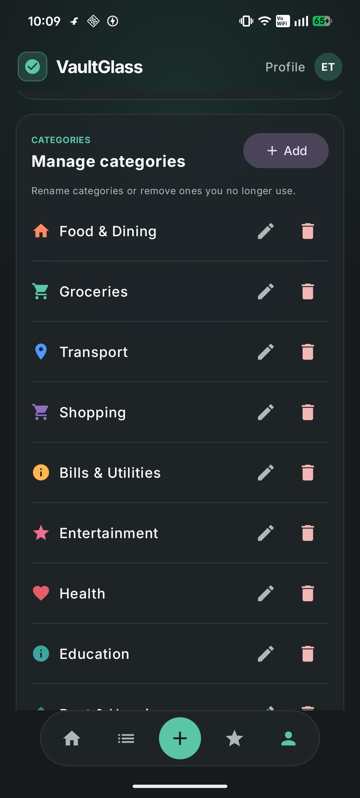

# Expense Tracker

An Android expense tracker that detects debit SMS messages and payment
notifications, asks the user to confirm incomplete transactions, stores data
offline in Room, synchronizes it to a FastAPI service on Render, and delivers
confirmed transactions to Databricks.

## Supported production architecture

```text
Android app
  -> HTTPS + Android Keystore request signatures
Render FastAPI
  -> Render PostgreSQL (operational data + retry queue)
Databricks SQL Warehouse
  -> Unity Catalog Bronze and Silver Delta tables
```

The Render backend is the only supported Databricks writer. The older Spark
API-polling examples remain in `databricks/jobs` for reference; do not schedule
them together with the backend writer.

## App preview



_Captured from the Android app. This screen contains no private transaction data._

## Repository map

| Path | Purpose |
| --- | --- |
| `app/` | Android application (Kotlin, Compose, Room) |
| `backend/` | FastAPI service, Render Blueprint, PostgreSQL models and tests |
| `databricks/` | Databricks table setup, connection checks and optional reports |
| `web/` | Optional Next.js dashboard; not compatible with phone-only auth yet |
| `backend/render.yaml` | File to select when creating the Render Blueprint |
| `backend/RENDER_DEPLOYMENT.md` | Detailed Render operations and recovery guide |
| `databricks/README.md` | Detailed Databricks setup and reporting guide |

Generated databases, `.env` files, `local.properties`, Gradle output and Spark
output are intentionally ignored by Git.

## Prerequisites

- Android Studio or JDK 17 with an Android SDK
- Python 3.11+
- A GitHub, GitLab or Bitbucket fork of this repository
- A Render account
- A Databricks workspace with Unity Catalog and a SQL Warehouse

## 1. Prepare Databricks

Create or choose:

1. A Unity Catalog catalog, for example `workspace` or `main`.
2. A running Serverless or Pro SQL Warehouse.
3. A Databricks personal access token or service-principal credential. A PAT is
   the simplest option for this repository; Databricks recommends OAuth for a
   longer-lived production service.

The token identity needs:

- `CAN USE` on the SQL Warehouse.
- `USE CATALOG` and permission to create/use the target schema.
- Permission to create, select and modify tables in that schema.

Create a local configuration file (never commit it):

```powershell
Copy-Item databricks/.env.example databricks/.env
```

Fill in `databricks/.env`:

```dotenv
DATABRICKS_SYNC_ENABLED=false
DATABRICKS_HOST=https://your-workspace.cloud.databricks.com
DATABRICKS_TOKEN=your-token
DATABRICKS_WAREHOUSE_ID=your-warehouse-id
DATABRICKS_CATALOG=your-catalog
DATABRICKS_SCHEMA=expense_tracker_dw
DATABRICKS_SYNC_INTERVAL_SECONDS=15
```

`DATABRICKS_HOST` is only the HTTPS workspace origin. Find the warehouse ID in
**SQL Warehouses > your warehouse > Connection details**.

Install the backend dependencies and create the schema and managed Delta
tables:

```powershell
python -m venv .venv
.\.venv\Scripts\Activate.ps1
python -m pip install -r backend/requirements.txt
python databricks/setup_remote_sync.py --setup
```

Successful output includes `Databricks warehouse connection verified` and
`Bronze/Silver tables ready`. This creates:

- `<catalog>.expense_tracker_dw.bronze_expenses`
- `<catalog>.expense_tracker_dw.silver_expenses`

Do not upload or schedule a separate API-polling notebook for production sync.
Render pushes confirmed transactions directly and reliably through its outbox.

## 2. Deploy the backend on Render

Push your fork, then in Render choose **New > Blueprint** and select:

```text
backend/render.yaml
```

Render creates the web service and PostgreSQL database. Enter these values when
prompted:

| Render variable | Value |
| --- | --- |
| `DATABRICKS_HOST` | Same workspace origin used above |
| `DATABRICKS_TOKEN` | Databricks token; mark it secret |
| `DATABRICKS_WAREHOUSE_ID` | SQL Warehouse ID |
| `DATABRICKS_CATALOG` | Unity Catalog catalog containing the schema |
| `DEVICE_AUTH_ENABLED` | `false` for the first deployment |
| `DEVICE_PAIRING_CODE` | A new random code with at least 24 characters |

The Blueprint supplies `DATABASE_URL`, `DATABRICKS_SCHEMA`, retry interval and
the remaining non-secret settings automatically.

Generate a pairing code locally:

```powershell
python -c "import secrets; print(secrets.token_urlsafe(32))"
```

After deployment, verify the public health endpoint:

```text
https://YOUR-SERVICE.onrender.com/health
```

It must return `{"status":"ok"}`. Verify the Databricks credentials locally
before copying the same values to Render:

```powershell
python backend/scripts/check_databricks.py
```

## 3. Install the Android app without Android Studio

The easiest installation uses the APK automatically built by GitHub Actions.
No Android Studio, Java setup or USB cable is required.

1. Open this repository on GitHub and select the **Actions** tab.
2. Open **Build installable APK** and select the newest successful green run.
   If there is no run yet, select **Run workflow**.
3. Under **Artifacts**, download `expense-tracker-apk`.
4. Extract the downloaded ZIP to get `ExpenseTracker.apk`.
5. If downloaded on a computer, send the APK to the Android phone. It can also
   be downloaded directly from GitHub using the phone browser.
6. Tap `ExpenseTracker.apk`. If Android asks, allow **Install unknown apps** for
   the browser or Files app, complete installation, and then disable that
   permission again.
7. Open the app's Settings dialog and enter the Render service origin:

   ```text
   https://YOUR-SERVICE.onrender.com
   ```

The GitHub APK intentionally contains no owner's backend URL, Databricks token,
database password or pairing code. Each installer connects it to their own
Render service in Settings.

GitHub keeps workflow artifacts for 30 days. A maintainer can run the workflow
again at any time to produce a fresh download.

### Optional developer build

Developers who want to modify the source can build locally. Android Studio is
optional; JDK 17 plus the Android SDK command-line tools are sufficient.

Copy `local.properties.example` to `local.properties` in the repository root.
Set the Android SDK path and Render service origin:

```properties
sdk.dir=C\:\\path\\to\\Android\\Sdk
BACKEND_BASE_URL=https\://YOUR-SERVICE.onrender.com
```

The backend URL is not a secret. It can alternatively be entered later through
the app's Settings dialog. No Databricks token, database password or pairing
code is compiled into the APK.

Build and install on a USB-debugging-enabled phone:

```powershell
.\gradlew.bat :app:installDebug
```

In Android settings, grant the app:

- SMS permission.
- Notification permission.
- Notification access, so payment-app notifications can be detected.

## 4. Pair the phone and enable protection

Use this order to avoid locking the phone out:

1. Keep Render `DEVICE_AUTH_ENABLED=false`.
2. In the app, open **Profile > Phone Security**.
3. Enter the same `DEVICE_PAIRING_CODE` and tap **Pair this phone**.
4. Wait for **This phone is paired**.
5. Change Render `DEVICE_AUTH_ENABLED=true` and redeploy.
6. Remove or rotate `DEVICE_PAIRING_CODE` after pairing.

The app creates an EC P-256 private key inside Android Keystore. Render stores
only the public key. Requests are signed with their method, exact URL,
timestamp, nonce and body hash; stale, modified and replayed calls are rejected.

If the app is uninstalled, follow the recovery procedure in
[`backend/RENDER_DEPLOYMENT.md`](backend/RENDER_DEPLOYMENT.md).

## 5. Confirm the end-to-end flow

1. Receive a debit SMS or add an expense manually.
2. If it needs a reason/category, confirm it in the app.
3. Check that it appears in Render/PostgreSQL.
4. In Databricks Catalog Explorer, query:

   ```sql
   SELECT *
   FROM YOUR_CATALOG.expense_tracker_dw.silver_expenses
   ORDER BY transaction_timestamp DESC;
   ```

Only confirmed transactions are sent to Databricks. Pending SMS drafts remain
in the app/backend until confirmed. Failed Databricks writes stay in the
PostgreSQL outbox and retry automatically.

## Optional: Databricks email reports

Workflow status emails and spending-report emails are different:

- For workflow success/failure notifications, use
  `databricks/configure_job_email.py` with your job ID and email.
- For a report containing spending data, create an AI/BI dashboard from
  `databricks/weekly_expense_report.sql`, schedule it, and subscribe an email.

See [`databricks/README.md`](databricks/README.md) for exact steps.

## Local development and tests

Run the backend locally:

```powershell
$env:PYTHONPATH="backend"
python -m uvicorn app.main:app --app-dir backend --reload
```

Run focused tests:

```powershell
$env:PYTHONPATH="backend"
python -m pytest backend/tests/test_device_auth.py -q
python backend/tests/test_databricks_delivery.py
.\gradlew.bat :app:testDebugUnitTest
```

Google Sheets sync remains optional and can be configured in the Android
Settings dialog. The Render/PostgreSQL/Databricks path is the supported hosted
deployment.

## Official platform references

- [Render Blueprint YAML reference](https://render.com/docs/blueprint-spec)
- [Render free-tier limits](https://render.com/docs/free)
- [Databricks authentication](https://docs.databricks.com/aws/en/dev-tools/auth)
- [Databricks SQL Warehouses](https://docs.databricks.com/aws/en/compute/sql-warehouse)
- [Databricks dashboard schedules and subscriptions](https://docs.databricks.com/aws/en/dashboards/share/schedule-subscribe)
